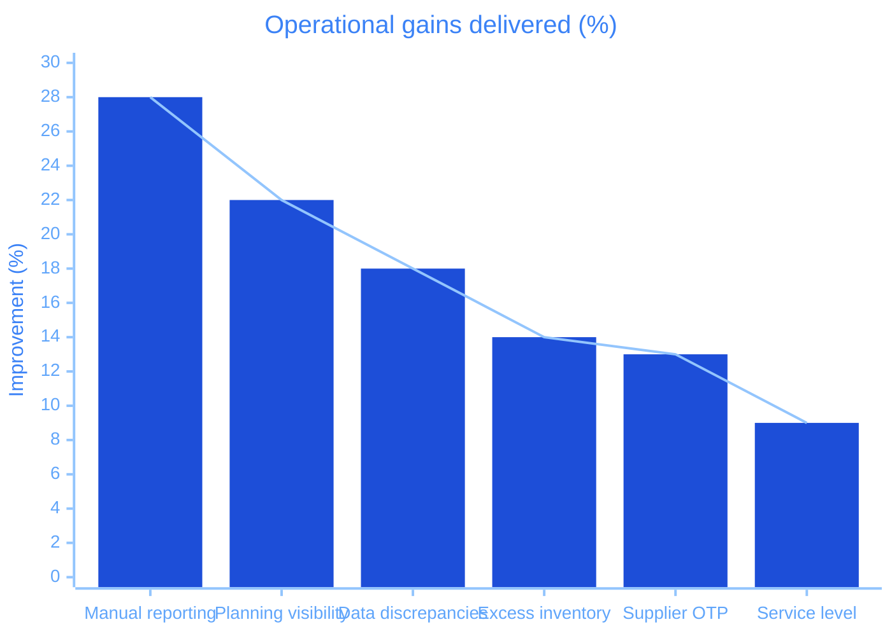
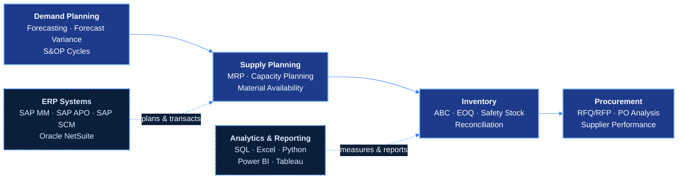
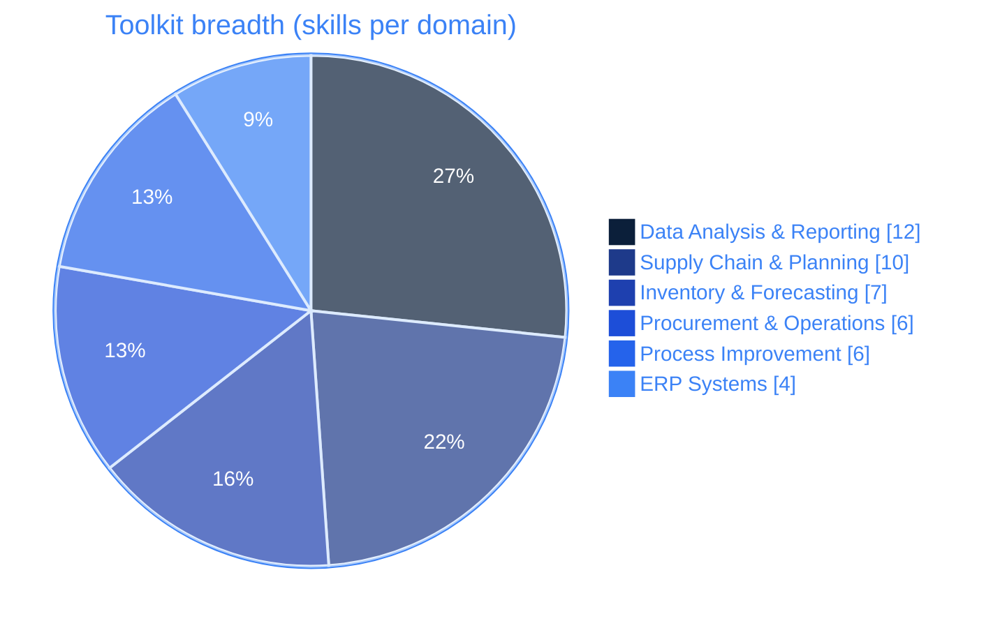

---

## Professional Summary

**Supply Chain Analyst** &nbsp;|&nbsp; **Demand & Supply Planning** &nbsp;|&nbsp; **Inventory Optimization & Procurement Analytics**

Supply Chain Analyst with **4+ years** across demand planning, supply planning, inventory management, procurement, S&OP, MRP, and forecasting in **consumer goods, retail pharmacy, and technology services**. Currently at **Mondelez International**, analyzing demand, supply, and inventory across **2,500+ SKUs** and **$25M+** in annual product flow with SAP APO, SAP SCM, SQL, and Excel. Previously supported replenishment and supplier performance for **180+ Walgreens retail and distribution locations**. Strong in inventory optimization, safety stock planning, supplier performance, purchase-order analysis, KPI reporting, and root cause analysis. **M.S. Supply Chain Management.**

**Core Competencies:**
- **Supply Chain & Planning:** Demand Planning, Supply Planning, S&OP, MRP, Order Fulfillment, Logistics Coordination
- **Inventory & Forecasting:** Demand Forecasting, ABC Analysis, EOQ, Safety Stock Planning, Capacity Planning, Inventory Reconciliation
- **Procurement & Suppliers:** RFQ/RFP Management, Purchase Order Analysis, Supplier Evaluation, Vendor Management, Cost Analysis
- **ERP Systems:** SAP MM, SAP APO, SAP SCM, Oracle NetSuite
- **Analytics & Reporting:** SQL, Excel (Power Query, VBA, XLOOKUP), Power BI, Tableau, Python (Pandas, NumPy)
- **Process Improvement:** Root Cause Analysis, KPI Reporting, Lean Six Sigma, Continuous Improvement

---

## Impact at a Glance

<table>
<tr>
<td align="center" width="16%"><h2>4+</h2>years in supply chain analytics</td>
<td align="center" width="16%"><h2>2,500+</h2>SKUs planned at Mondelez</td>
<td align="center" width="16%"><h2>$25M+</h2>annual product flow supported</td>
<td align="center" width="16%"><h2>180+</h2>retail & distribution locations analyzed</td>
<td align="center" width="16%"><h2>8,000+</h2>purchase orders reviewed</td>
<td align="center" width="16%"><h2>40+</h2>suppliers tracked</td>
</tr>
</table>

---

## End-to-End Supply Chain Expertise

---

## Technology Stack & Expertise

| **Category** | **Technologies & Skills** |
|:------------|:----------------|
| **Supply Chain & Planning** | Demand Planning, Supply Planning, Inventory Management, Procurement, S&OP, Material Requirements Planning (MRP), Supplier Performance Management, Vendor Management, Logistics Coordination, Order Fulfillment |
| **ERP & Supply Chain Systems** | SAP MM, SAP APO, SAP SCM, Oracle NetSuite |
| **Data Analysis & Reporting** | SQL, Microsoft Excel (Pivot Tables, Power Query, VBA, VLOOKUP, XLOOKUP), Power BI, Tableau, Python (Pandas, NumPy) |
| **Inventory & Forecasting** | Demand Forecasting, Inventory Optimization, ABC Analysis, EOQ, Safety Stock Planning, Capacity Planning, Inventory Reconciliation |
| **Procurement & Operations** | RFQ/RFP Management, Purchase Order Analysis, Supplier Evaluation, Contract Support, Procurement Analytics, Cost Analysis |
| **Process Improvement** | Root Cause Analysis, KPI Reporting, Lean Six Sigma, Continuous Improvement, Cross-Functional Collaboration, Data Validation |

---

## Professional Experience

  

<b>Supply Chain Analyst · Mondelez International</b> &nbsp;|&nbsp; Aug 2024 – Present &nbsp;|&nbsp; USA &nbsp;(click to collapse)

 

<table>
<tr>
<td align="center" width="20%"><h3>2,500+</h3>SKUs across product categories</td>
<td align="center" width="20%"><h3>14%</h3>less excess inventory</td>
<td align="center" width="20%"><h3>13%</h3>better on-time supplier performance</td>
<td align="center" width="20%"><h3>22%</h3>better planning visibility</td>
<td align="center" width="20%"><h3>28%</h3>less manual reporting</td>
</tr>
</table>

| Focus | What I do |
|:--|:--|
| **Demand & supply analysis** | Analyze demand, supply, and inventory across **2,500+ SKUs** using **SAP APO, SAP SCM, SQL, and Excel**, supporting planning decisions for **$25M+** in annual product flow |
| **S&OP support** | Bring forecast, inventory, capacity, and material-requirement data into **Power BI** for S&OP and supply-planning cycles, improving planning visibility and exception identification by **22%** |
| **Inventory optimization** | Apply demand forecasting, **ABC analysis, and safety stock planning** to rebalance inventory, contributing to a **14%** reduction in excess inventory across monitored categories |
| **Service level** | Evaluate supply constraints, forecast variance, and material availability to reduce stockout exposure, contributing to a **9%** improvement in service-level performance |
| **Supplier performance** | Analyze supplier and procurement activity across **40+ suppliers**, using KPI trends and root cause analysis to support a **13%** improvement in on-time supplier performance |
| **KPI reporting & data quality** | Build recurring KPI reporting on inventory, forecast accuracy, fulfillment, and supplier metrics (**28%** less manual effort); validate and reconcile planning data, cutting recurring discrepancies by **18%** |

`SAP APO` `SAP SCM` `SQL` `Excel` `Power BI` `S&OP` `Demand Forecasting` `ABC Analysis` `Safety Stock` `Supplier KPIs` `Root Cause Analysis`

<b>Supply Chain Analyst · Walgreens</b> &nbsp;|&nbsp; Mar 2023 – Jul 2024 &nbsp;|&nbsp; USA &nbsp;(click to expand)

 

<table>
<tr>
<td align="center" width="25%"><h3>180+</h3>retail & distribution locations</td>
<td align="center" width="25%"><h3>8,000+</h3>purchase orders reviewed</td>
<td align="center" width="25%"><h3>18 hrs</h3>of manual reporting saved per month</td>
<td align="center" width="25%"><h3>~$35M</h3>annual sales in product flow supported</td>
</tr>
</table>

| Focus | What I did |
|:--|:--|
| **Replenishment analysis** | Analyzed demand, replenishment, and inventory trends across **180+ retail and distribution locations** using **SQL and Excel** to support inventory and replenishment decisions |
| **Forecasting & exceptions** | Evaluated demand patterns, forecasting results, and replenishment exceptions to identify shortage risks and inventory imbalances across assigned product categories |
| **BI reporting** | Built **Power BI and Tableau** reporting for inventory, order fulfillment, supplier activity, and supply chain KPIs, saving **18 hours per month** of manual reporting |
| **PO & supplier reviews** | Ran purchase-order analysis, inventory reconciliation, and supplier performance reviews across **8,000+ purchase orders** to surface unresolved supply discrepancies |
| **Inventory optimization** | Applied **safety stock, EOQ, and inventory optimization** analysis to support replenishment decisions and maintain appropriate inventory levels |
| **Cross-functional coordination** | Worked with procurement, vendors, logistics, and operations to resolve fulfillment exceptions on product flow tied to about **$35M** in annual sales |

`SQL` `Excel` `Power BI` `Tableau` `Replenishment` `EOQ` `Safety Stock` `PO Analysis` `Inventory Reconciliation` `Supplier Performance`

<b>Supply Chain Coordinator · Hexaware Technologies</b> &nbsp;|&nbsp; Jun 2019 – Dec 2020 &nbsp;|&nbsp; India &nbsp;(click to expand)

 

<table>
<tr>
<td align="center" width="33%"><h3>100+</h3>supply chain transactions per month</td>
<td align="center" width="33%"><h3>15+</h3>sourcing requests supported</td>
<td align="center" width="33%"><h3>Recurring</h3>status & KPI reporting</td>
</tr>
</table>

| Focus | What I did |
|:--|:--|
| **PO & logistics coordination** | Coordinated purchase-order tracking, vendor follow-up, and logistics for **100+ supply chain transactions per month**, keeping open requirements and delivery commitments visible |
| **Sourcing support** | Supported **RFQ/RFP management** and supplier evaluation across **15+ sourcing requests** by organizing pricing, lead-time, and operational information for procurement review |
| **Data reconciliation** | Used **Excel (VLOOKUP, XLOOKUP, Pivot Tables, Power Query)** to reconcile supply chain records, validate data, and resolve transactional discrepancies |
| **Vendor follow-up** | Reviewed purchase orders, delivery schedules, and vendor updates to track open requirements and coordinate follow-up with suppliers and internal stakeholders |
| **Reporting** | Prepared recurring supply chain status updates and KPI reports covering outstanding coordination items and delivery commitments |

`Excel` `Power Query` `XLOOKUP` `Pivot Tables` `RFQ/RFP` `Supplier Evaluation` `PO Tracking` `Logistics Coordination`

---

## Projects

| **Project** | **What it does** | **Tech** |
|:-----------|:----------------|:--------|
| [**Retail Margin Cockpit**](https://github.com/Dhruv5770/retail-margin-cockpit) | Turns raw POS, Shopify, and inventory exports into a tested star schema with a DAX measure library and an RLS-scoped Power BI margin & inventory cockpit | `dbt` `SQL` `Power BI` `DAX` `Python` |
| [**Field Ops SQL Cost Audit**](https://github.com/Dhruv5770/field-ops-sql-cost-audit) | Reconciles messy dispatch, route, timesheet, and fuel data into true cost-to-serve per job and route, and shows where SLA breaches concentrate | `dbt` `SQL` `Tableau` `GitHub Actions` |
| [**Retail Data Analytics: Python + SQL**](https://github.com/Dhruv5770/retail-data-analytics-project-python-sql-integration) | End-to-end retail order analysis: Kaggle API extraction, Pandas cleaning, SQL Server load, and SQL-driven insights | `Python` `Pandas` `SQL Server` |
| [**Personal Finance Database**](https://github.com/Dhruv5770/finances-database) | MySQL dimensional model of every bank and credit card transaction, with an ETL pipeline and a Power BI spending dashboard | `MySQL` `Python` `SQLAlchemy` `Power BI` |
| [**Online Payments Fraud Detection**](https://github.com/Dhruv5770/online-payments-fraud-detection-with-machine-learning) | Classifies fraudulent vs. legitimate online payment transactions with a machine learning model | `Python` `Pandas` `scikit-learn` |

---

## GitHub Activity

<!-- Live cards: these update automatically from GitHub data, no workflow needed. -->

 

---

## Contribution Activity

<!--
  The blue snake SVGs are generated by .github/workflows/snake.yml.
  Run it once after the first push (Actions -> Generate Snake -> Run workflow) to create the "output" branch;
  until then the image shows as broken (404).
-->

  <picture>
    <source media="(prefers-color-scheme: dark)" srcset="https://raw.githubusercontent.com/Dhruv5770/Dhruv5770/output/snake-blue-dark.svg" />
    <source media="(prefers-color-scheme: light)" srcset="https://raw.githubusercontent.com/Dhruv5770/Dhruv5770/output/snake-blue.svg" />
    
  </picture>

---

## Education

| **Degree** | **Institution** | **Duration** |
|:----------|:---------------|:------------:|
| **Master of Science in Supply Chain Management** | The University of Texas, TX, USA | Jan 2021 – Jan 2023 |
| **Bachelor of Technology in Mechanical Engineering** | Charusat University, Gujarat, India | Jan 2017 – Feb 2020 |

---

## Let's Connect

**Location:** Texas, USA &nbsp;|&nbsp; **Email:** [dhruv.d2715@gmail.com](mailto:dhruv.d2715@gmail.com) &nbsp;|&nbsp; **Phone:** [+1 (214) 742-0797](tel:+12147420797)

